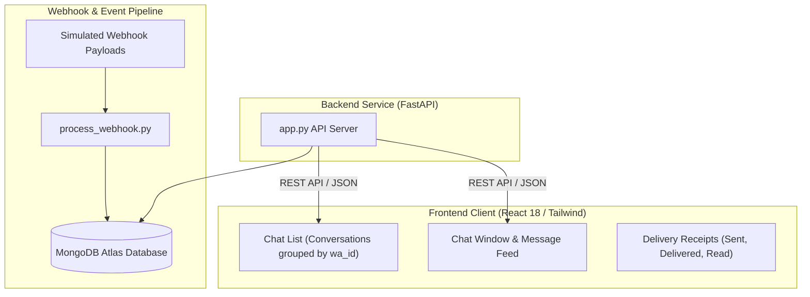

<div align="center">

# 📱 WhatsApp Web Full-Stack Simulator

**A full-stack WhatsApp Web simulation engine featuring a FastAPI backend with MongoDB Atlas persistence and a reactive React 18 & Tailwind CSS client.**

[](https://fastapi.tiangolo.com)
[](https://react.dev)
[](https://mongodb.com)
[](https://tailwindcss.com/)
[](LICENSE)

[Overview](#-overview) • [Architecture](#-architecture) • [Features](#-features) • [Quickstart](#-quickstart-guide) • [API Endpoints](#-api-endpoints)

</div>

---

## 💡 Overview

This project implements an end-to-end full-stack messaging simulator replicating the core UX and data flow of WhatsApp Web. It ingests simulated webhook payloads (messages and delivery status receipts), normalizes conversation threads by phone ID (`wa_id`), and renders an authentic, responsive WhatsApp Web interface.

---

## 🏗️ Architecture



---

## ✨ Features

- **📨 Webhook Payload Processing**: Parses incoming message and status receipt events into persistent MongoDB collections.
- **👥 Contact Grouping**: Automatically groups and sorts conversations by sender `wa_id` with timestamps.
- **✔️ Message Receipt Statuses**: Visual checkmark indicators reflecting message progression (`sent ✓`, `delivered ✓✓`, `read ✓✓`).
- **📱 Pixel-Perfect UI**: Authentic WhatsApp Web styling built with React 18, Vite, and Tailwind CSS.
- **🛡️ Secure Environment**: Credentials decoupled from source control via `.env.example`.

---

## 🚀 Quickstart Guide

### 1. Clone the Repository
```bash
git clone https://github.com/deekshi07/whatsapp-web.git
cd whatsapp-web
```

### 2. Backend Setup
```bash
cd backend
python -m venv venv

# Windows
.\venv\Scripts\activate
# macOS / Linux
source venv/bin/activate

pip install -r requirements.txt # or uv pip install fastapi uvicorn pymongo certifi python-dotenv
```

Configure backend `.env`:
```bash
cp .env.example .env
```
Provide your MongoDB Atlas connection string in `.env`.

Process sample webhook events and launch API:
```bash
python process_webhook.py
python -m uvicorn app:app --reload --port 8000
```

### 3. Frontend Setup
```bash
cd ../frontend
npm install
npm run dev
```
Open **[http://localhost:5173](http://localhost:5173)** to interact with the web client.

---

## 🔌 API Endpoints

| Method | Endpoint | Description |
| :--- | :--- | :--- |
| `GET` | `/messages` | Returns all conversation threads grouped by `wa_id` |
| `GET` | `/messages/{wa_id}` | Retrieves chronological message history for a specific contact |
| `POST` | `/messages` | Appends a new outgoing simulated message to the conversation |
| `GET` | `/health` | Health check endpoint returning backend status |

---

## 📄 License

This project is open-source and licensed under the [MIT License](LICENSE).
